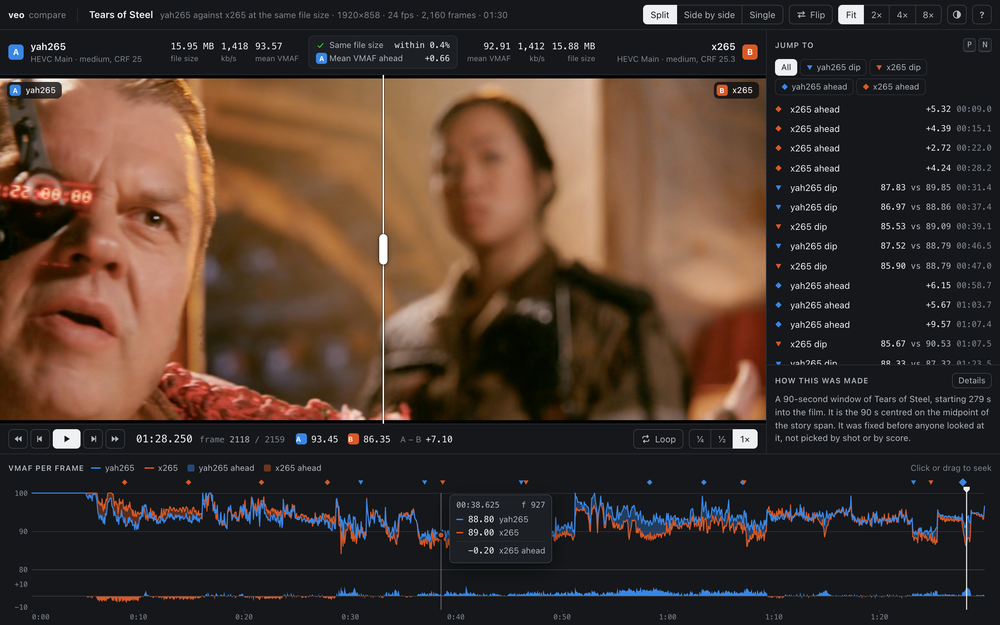
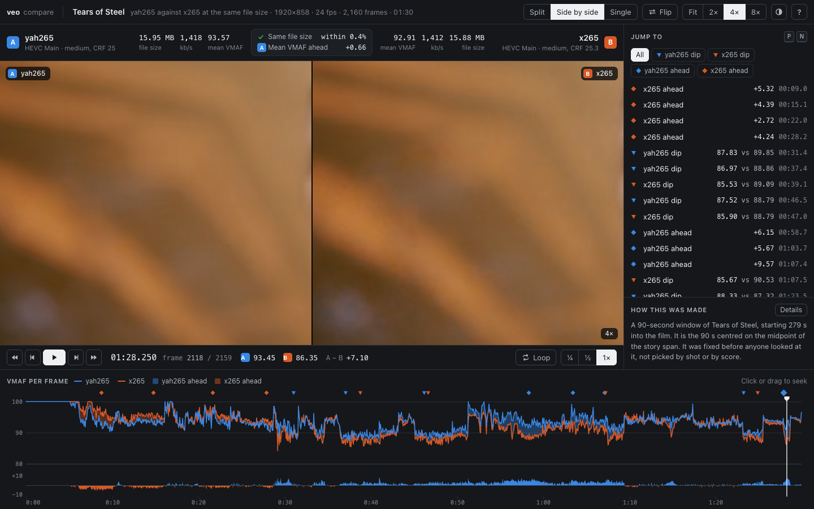
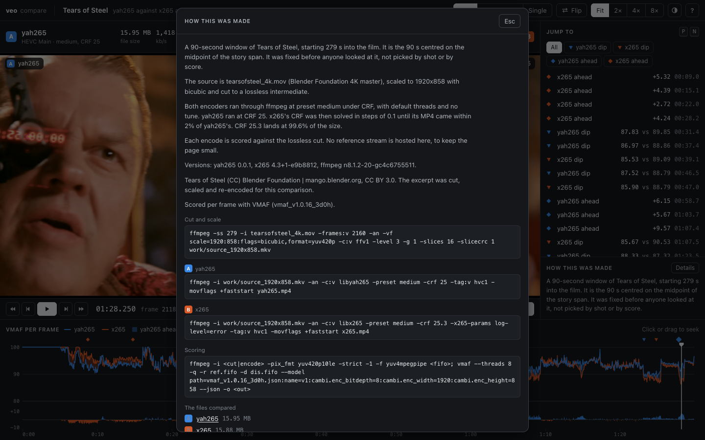
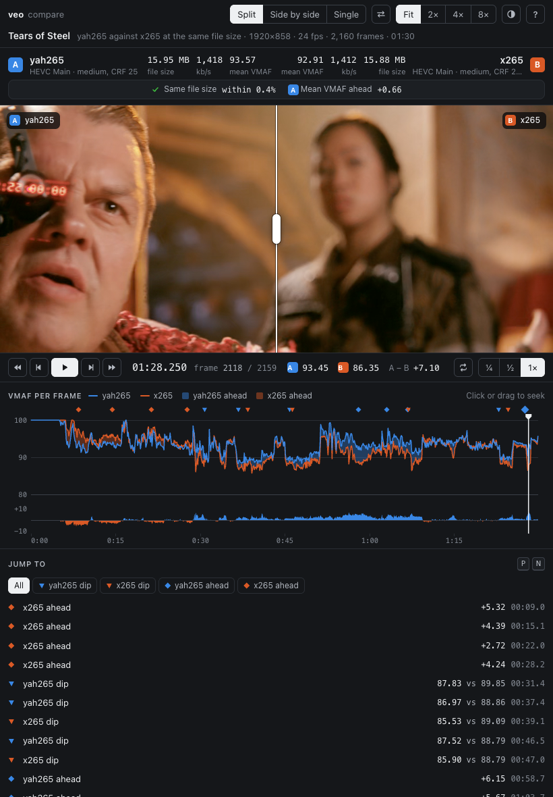
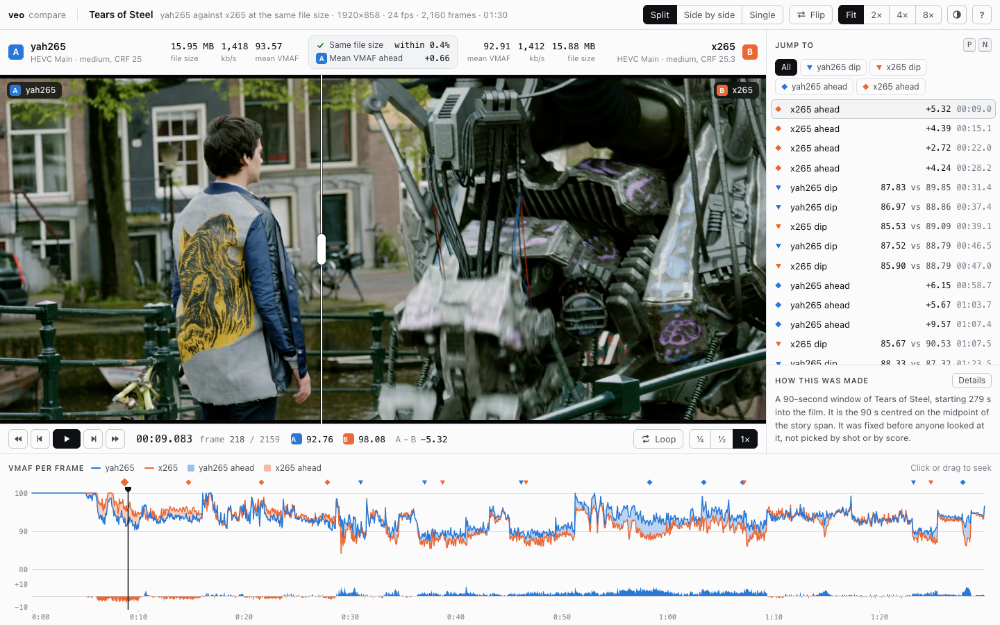

# Comparison Player

`veo compare` puts two encodes of the same source next to each other in a
browser and keeps them on the same frame. Give it each encode's per-frame
VMAF log and it draws both curves on one timeline, then lists the moments
where a viewer should look.



The screenshots show a 90-second window of Tears of Steel (CC BY 3.0,
Blender Foundation). Both encodes are HEVC at the same file size.

## What the screen shows

The strip above the picture names each encode with its codec, settings, file
size, bitrate and mean VMAF. Between the two sits the fairness check. It
says whether the files are within 2% of each other in size. It also says
which encode has the higher mean score. A comparison at unequal sizes gets a
warning there.

The picture is a split by default. Drag the divider, or click anywhere on
the picture to move it. Side by side shows both pictures whole. Single
shows one stream at a time, where `F` flips between A and B in place.
That flip is the quickest way to see a difference.

Zoom goes to 2x, 4x and 8x. The same pixels stay under the pointer on each side because both pictures
zoom and pan together.



The timeline at the bottom plots VMAF per frame for both encodes on one
axis. The area between the curves takes the color of the encode that is
ahead. A second strip under the curves plots A minus B around zero, because
a gap of one point is hard to read off two lines that nearly touch. Click
or drag anywhere on the timeline to seek. Hovering reads out both scores
and the gap at that frame.

### Jump points

The player picks the frames to visit, because a viewer who scrubs at
random learns little. For each pair of encodes it lists these kinds of jump
point:

- each encode's own lowest stretches, called dips
- the stretches where A is furthest ahead of B
- the stretches where B is furthest ahead of A

They appear as a list beside the picture and as markers above the timeline.
`N` and `P` step through them in time order. The chips above the list
narrow it to one kind, and then the list sorts by strength.

Both directions are always listed. In the Tears of Steel example the
first four jump points are places where x265 is ahead. They are as easy
to reach as the ones where yah265 leads.

Jump points are ranked on a half-second moving average. That way a
stretch a viewer can see outranks a one-frame blip. A dip counts once it
is one VMAF point under that encode's mean. A lead counts once the two
encodes are half a point apart. The single worst stretch of each encode
is listed even when it is shallower than that.

### More than two encodes

A comparison can hold up to four encodes. The player shows two at a time.
When there are more than two, the names in the top strip become menus
for choosing the encode on each side. The curves, the jump points and the
fairness check all follow the choice.

### How this was made

The panel under the jump list shows the first paragraph of the notes
given at export. Details opens the rest: the full text, the commands,
links, and a download link for each file compared.



## Quick start

```bash
# Per-frame VMAF for each encode, against the same source
veo quality measure --reference source.mp4 --distorted ours.mp4 \
  --per-frame -o ours.vmaf.json
veo quality measure --reference source.mp4 --distorted x265.mp4 \
  --per-frame -o x265.vmaf.json

# Open the player
veo compare \
  --a ours.mp4 --vmaf-a ours.vmaf.json --label-a yah265 --detail-a "medium, CRF 25" \
  --b x265.mp4 --vmaf-b x265.vmaf.json --label-b x265   --detail-b "medium, CRF 25.3"
```

A log written by libvmaf itself works too. The player reads
`frames[].metrics.<name>`, where the name defaults to `vmaf`. Pass
`--metric` when a model was loaded under another name.

With only `--a`, the player compares that one encode against
`--reference`.

## Static export

```bash
veo compare export --out site/tears-1080p \
  --a ours.mp4 --vmaf-a ours.vmaf.json --label-a yah265 --detail-a "medium, CRF 25" \
  --b x265.mp4 --vmaf-b x265.vmaf.json --label-b x265   --detail-b "medium, CRF 25.3" \
  --title "Tears of Steel" --subtitle "yah265 against x265 at the same file size" \
  --metric v1 --metric-label VMAF --model vmaf_v1.0.16_3d0h \
  --notes how-made.json

veo compare index site      # index.html over every export in site/
veo compare preview site    # serve it locally
```

The export is a folder that any static host can serve, GitHub Pages
included. Nothing in it loads from another site. It ends by printing the
folder's total size.

```
site/tears-1080p/
  index.html  css/player.css  js/player.js
  manifest.json
  .nojekyll
  media/
    a.mp4                 the whole encode: the download, and the last-resort playback
    a/index.m3u8          HLS playlist over the segments
    a/init.mp4            init segment
    a/seg-00000.m4s ...   one media segment per run of GOPs
    b.mp4  b/ ...
```

`veo compare index DIR` writes a landing page over every export one level
down. A folder of exports with that page is ready to publish as a site.

Use `veo compare preview` to look at an export locally. Python's
`http.server` doesn't answer range requests, and seeking a whole MP4
depends on them.

### How the video is delivered

The export repackages each encode as fragmented MP4 (CMAF) with `-c copy`.
It never re-encodes. Fragments start only at key frames the encoder
placed, because each encoder's own GOP structure is part of what is being
compared. Short GOPs are joined until a segment is at least two seconds
long. After packaging, the export hashes the elementary stream of the
source file and of the segments. It fails if the two differ.

The player picks a path per stream:

1. Safari and iOS play the HLS playlist natively.
2. Other browsers get the same segments through Media Source Extensions.
   The player uses ManagedMediaSource where the browser has it.
3. Otherwise the whole MP4 plays.
4. If the browser can't decode the codec at all, the stream's fallback
   file plays and its label says "proxy". With no fallback, the pane says
   which browsers can play it. The timeline works either way.

Segments keep 4K practical. The player fetches the segment under the
playhead first and then about 24 seconds ahead. It drops what is more than
a few seconds behind. A seek abandons a fetch the playhead has left.
No file comes near the 100 MB limit of GitHub Pages. When a whole MP4 is over that limit, the export leaves it out and still
writes its segments.

### Frame accuracy

Both sides have to show the same frame number, and two things get in the
way.

The muxer shifts each stream forward, because fragmented MP4 can't store
the negative decode times a whole MP4 uses for B-frames. Two encoders with
different reorder depths shift by different amounts. In the example,
yah265 moves by 0.125 s and x265 by 0.083 s. The manifest records each
stream's shift as `segments.start`. Once the player subtracts it, frame N
is at the same time on both sides.

The second is the browser. In Chrome, seeking a whole MP4 shows the
wrong picture just before an open-GOP key frame. On the example, a run of
frames before frame 250 all showed frame 250. The run was six frames long
on one encode and four on the other. Through segments, every frame I
tested matched ffmpeg's decode of that frame on both encodes. That is why
`veo compare` also writes segments into a temporary folder before it
serves. Without
ffmpeg it serves the whole files and warns.

I've checked the Media Source path in Chrome. I haven't run the native HLS path in Safari on a device. It is written to
measure its own time offset on load.

### Hosting

- **Resolutions.** Each resolution of a title is its own export. Link them
  with `--variant` to get a switch in the player's top bar. A
  viewer's browser fetches nothing of the 4K export until they pick it.

  ```bash
  veo compare export --out site/tears-1080p --variant 1080p --variant 4K=../tears-4k/ ...
  veo compare export --out site/tears-4k    --variant 1080p=../tears-1080p/ --variant 4K ...
  ```

- **Reference.** A reference is optional. A near-lossless one is
  usually too large to host. Leave it out, or name one hosted elsewhere
  with `--reference-url`. Nothing is copied for it.
- **Moving the videos.** Every video path in the manifest is relative to
  one field, `mediaBase`. Upload the `media/` folder to object storage and
  export with `--media-base https://media.example.com/tears-1080p/`, or
  edit that one field. The other host must allow cross-origin requests
  from the page.
- **Private paths.** The export trims every local absolute path in the
  notes, commands and labels down to its file name. A path under a home
  or volume folder becomes just `ffmpeg`, for example. It refuses to write
  a manifest that still contains one.

## Manifest format

The player reads `manifest.json` from beside `index.html`. The export
writes it. You can also write or edit one by hand.

```json
{
  "version": 1,
  "title": "Tears of Steel",
  "subtitle": "yah265 against x265 at the same file size",
  "fps": 24,
  "frames": 2160,
  "width": 1920,
  "height": 858,
  "metric": { "key": "v1", "label": "VMAF", "model": "vmaf_v1.0.16_3d0h" },
  "mediaBase": "media/",
  "variants": [
    { "label": "1080p" },
    { "label": "4K", "href": "../tears-4k/" }
  ],
  "encodes": [
    {
      "id": "a",
      "label": "yah265",
      "codec": "HEVC Main",
      "detail": "medium, CRF 25",
      "src": "a.mp4",
      "mime": "video/mp4; codecs=\"hvc1.1.6.L120.B0\"",
      "segments": {
        "playlist": "a/index.m3u8",
        "init": "a/init.mp4",
        "start": 0.125,
        "list": [
          { "src": "a/seg-00000.m4s", "start": 0, "duration": 10.166667, "bytes": 1596211 }
        ]
      },
      "fallback": { "src": "a-fallback.mp4", "mime": "video/mp4; codecs=\"avc1.640028\"" },
      "bytes": 15948193,
      "bitrateKbps": 1417.6,
      "score": { "mean": 93.571, "min": 86.972, "max": 100, "p5": 88.993 },
      "scores": [100, 100, 99.87]
    }
  ],
  "reference": { "id": "reference", "label": "Source", "src": "https://media.example.com/source.mp4" },
  "compare": { "a": "a", "b": "b" },
  "moments": {
    "a|b": [
      { "kind": "lead", "side": "b", "rank": 1, "frame": 218, "time": 9.083 },
      { "kind": "dip", "side": "a", "rank": 1, "frame": 898, "time": 37.417 }
    ]
  },
  "notes": {
    "heading": "How this was made",
    "body": ["One paragraph per entry."],
    "commands": [{ "label": "yah265", "encode": "a", "text": "ffmpeg -i source.mkv ..." }],
    "links": [{ "label": "Source", "url": "https://example.com/" }]
  }
}
```

| Field | Meaning |
|-------|---------|
| `fps`, `frames` | Frame N is shown at `(N + 0.5) / fps` seconds. The rate must be constant. |
| `metric.key` | The name under `frames[].metrics` that the scores came from. `label` is what the player prints. |
| `mediaBase` | What every `src`, `init` and `playlist` is relative to. May be an absolute URL. |
| `variants` | Other resolutions of the title. The entry without `href` is this page. |
| `encodes[]` | One to four encodes. `id` is any short string. |
| `encodes[].src` | The whole file. Optional when `segments` is present. |
| `encodes[].mime` | Container and codec string. The player asks the browser about it before loading anything. |
| `encodes[].segments.start` | Presentation time of the first frame on the segments' timeline, in seconds. |
| `encodes[].segments.list[]` | Media segments in order. `start` counts from the first frame, and `bytes` sizes the player's buffer. |
| `encodes[].fallback` | A file to play where the codec can't be decoded. It is a different encode, and the player labels it so. |
| `encodes[].score` | Summary of `scores`. `p5` is the 5th percentile. |
| `encodes[].scores` | One value per frame, starting at frame 0. |
| `reference` | Optional. Same shape as an encode, without scores. |
| `compare` | The encode ids the player opens with on sides A and B. |
| `moments` | Jump points per pair, under `"idA\|idB"`. `side` "a" is the first id of the key. `kind` is `dip` or `lead`. A lone encode's dips sit under its own id. |
| `notes` | Text for the "how this was made" panel. A command's `encode` is an encode id or `reference`. |

The player needs only `fps`, `frames`, `metric` and one encode with a
`src` or `segments`. Without `scores` it still plays, with an empty
timeline.

### Notes file

`--notes` takes a `.json` file in the shape of `notes` above. Any other
file is read as plain text, with one paragraph per blank-line block.

## Flags

### `veo compare` and `veo compare export`

| Flag | Description |
|------|-------------|
| `--a`, `--b`, `--c`, `--d` | The encodes. A and B open on screen, and the viewer can swap in C and D. Only `--a` is required. |
| `--vmaf-a` ... `--vmaf-d` | Per-frame VMAF JSON for each encode |
| `--label-a` ... `--label-d` | Name shown for each encode, usually the encoder |
| `--detail-a` ... `--detail-d` | Settings shown beside the name |
| `--fallback-a` ... `--fallback-d` | File to play where the browser can't decode the encode |
| `--reference` | Source or near-lossless reference to copy into the export |
| `--reference-url` | A reference hosted elsewhere |
| `--label-reference` | Name shown for the reference (default "Source") |
| `--title`, `--subtitle` | Heading of the page |
| `--notes` | The "how this was made" text |
| `--metric` | Metric name in the logs (default `vmaf`) |
| `--metric-label`, `--model` | What the player prints for the metric, and the model it names |
| `--fps` | Frame rate, when the probe can't tell |
| `--moments` | Jump points per kind and side (default 4) |
| `--variant` | Another resolution, as `LABEL=HREF`. `LABEL` alone names this one. |
| `--no-segments` | Use the whole MP4s as they are |

`veo compare` also takes `--port` (default 8787) and `--no-open`.

### `veo compare export` only

| Flag | Description |
|------|-------------|
| `--out`, `-o` | Folder to write |
| `--media-base` | Where the page loads videos from (default `media/`) |
| `--no-progressive` | Host only the segments, without the whole MP4s |

Packaging needs ffmpeg and ffprobe. See the path rules in the README.

## Browser support for HEVC

Safari plays HEVC in MP4 tagged `hvc1`. Chrome and Edge play it where the
hardware decodes it. Most recent machines do. Firefox depends on
the operating system. Tag HEVC as `hvc1` when muxing, because Safari
refuses the `hev1` tag:

```bash
ffmpeg -i in.mkv -c copy -tag:v hvc1 -movflags +faststart out.mp4
```

For browsers that can't decode it, pass an H.264 transcode as
`--fallback-a`. The player marks that stream as a proxy. Nobody should judge an
encoder by its stand-in.

## Keyboard

Press `?` in the player for this list.

| Key | Action |
|-----|--------|
| Space | Play or pause |
| Left, Right | Step one frame. With Shift, one second. |
| Home, End | First or last frame |
| `N`, `P` | Next or previous jump point (`]` and `[` also work) |
| `S`, `D` | Split view, side by side |
| `1`, `2`, `3` | Only A, only B, only the reference |
| `F` | Flip A and B |
| Hold `R` | Show the reference while held |
| `Z` | Cycle zoom: fit, 2x, 4x, 8x |
| `+`, `-`, `0` | Zoom in, zoom out, fit |
| `L` | Loop two seconds around the current frame |
| `,`, `.` | Slower, faster |
| `I` | How this was made |
| `T` | Light or dark theme |

Dragging pans a zoomed picture. The wheel zooms at the pointer. A
double-click zooms in on a spot.

A copied link opens on the same picture, because the address bar tracks
the frame, the view, the zoom and the chosen encodes. From the console,
`veoCompare.seek(898)` goes to a frame.

## Smaller screens

Below about 940 px the layout becomes one column: picture, timeline, then
the jump list.



The theme follows the system setting until `T` or the toolbar button
overrides it.


